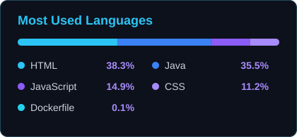

## ▌ About

I design and build **backend APIs, microservices and real-time systems** with Java and Spring Boot. Trained through hands-on courses and project-based work, with a strong focus on clean architecture, security and reliable messaging.

## ▌ Core Expertise

<table>
  <tr>
    <td width="50%" valign="top">
      <h3>Backend &amp; REST APIs</h3>
      Designing and building clean, well-structured RESTful APIs with <b>Java</b> and <b>Spring Boot</b>, with layered architecture and proper validation and error handling.
    </td>
    <td width="50%" valign="top">
      <h3>Microservices &amp; Real-time Systems</h3>
      Splitting systems into independent services that communicate through <b>Kafka</b> and <b>RabbitMQ</b>, and building real-time, event-driven flows.
    </td>
  </tr>
  <tr>
    <td width="50%" valign="top">
      <h3>Databases &amp; Persistence</h3>
      Data modeling and access with <b>Spring Data JPA</b>, <b>PostgreSQL</b>, <b>MySQL</b>, <b>MongoDB</b> and <b>Supabase</b>, covering both relational and NoSQL approaches.
    </td>
    <td width="50%" valign="top">
      <h3>Security</h3>
      Authentication and authorization flows with <b>Spring Security</b>, protecting endpoints and managing access across services.
    </td>
  </tr>
  <tr>
    <td width="50%" valign="top">
      <h3>Messaging &amp; Caching</h3>
      Asynchronous communication with <b>Kafka</b> and <b>RabbitMQ</b>, and performance improvements through <b>Redis</b> caching.
    </td>
    <td width="50%" valign="top">
      <h3>DevOps, Cloud &amp; Testing</h3>
      Cloud services on <b>AWS</b> and <b>Cloudinary</b>, version control with <b>GitHub</b> and <b>GitLab</b>, and unit, mock and integration testing.
    </td>
  </tr>
</table>

## ▌ Tech Stack

**Languages**

**Frameworks**

**Databases**

**Messaging & Cache**

**Testing**

**DevOps & Cloud**

**AI Tools**

## ▌ Additional Skills

## ▌ GitHub Stats

## ▌ Contact

